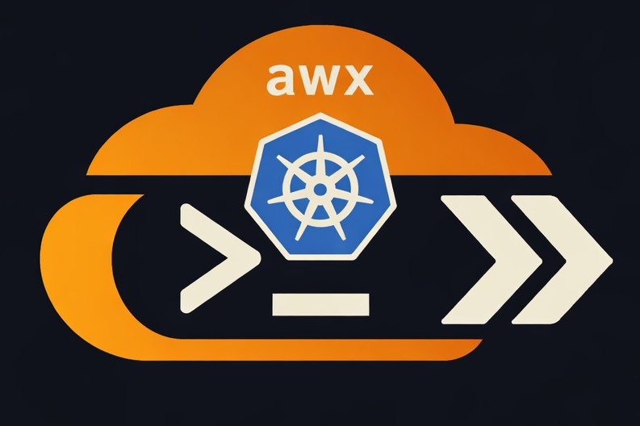

<div align="center">
  

# awx


[](https://opensource.org/licenses/MIT)

_Blazingly Fast AWS Profile & EKS Context Switcher_
</div>

## Overview

`awx` is a small Bash CLI. It helps you change AWS profiles and manage EKS kubeconfig files in multi-account AWS setups. It works with SSO profiles and with static credential profiles.

## Features

- Select an AWS profile interactively with [`fzf`](https://github.com/junegunn/fzf). A non-interactive mode is also available for scripts and automation: `awx use --profile X --cluster Y`
- Go back to the previous AWS profile and EKS cluster with **`awx -`** (like `cd -`)
- Change between existing kubeconfig contexts with **`awx ctx`**
- Use Zsh tab completion for commands, subcommands, and AWS profile names
- Re-authenticate the SSO session automatically on each profile change. If your session expires during the day, `awx` finds this and logs you in again. If SSO fails, `awx` uses static credentials when they are available
- Manage the EKS kubeconfig with a cache. The cache skips an update when the target context already exists
- Show all configured AWS profiles with their `ACTIVE` or `EXPIRED` session status and the remaining SSO session time with **`awx profiles`**
- Show the active profile, region, and EKS cluster with **`awx current`**
- Reset the environment and delete cached data with **`awx clear`**
- Force a refresh of the SSO session with **`awx refresh`**

## Usage
Use `awx` to manage AWS profiles and EKS kubeconfig contexts. These are the main commands:

```sh
# Interactive mode (prompts with fuzzy finder)
awx                                          # Select AWS profile and cluster
awx use                                      # Same as awx
awx profile-name                             # Shortcut: set profile, then select cluster

# Non-interactive mode (for scripts and automation)
awx use --profile my-profile                 # Set profile without prompts
awx use --profile my-profile --cluster myc   # Fully non-interactive
awx --profile my-profile                     # Top-level flag (equivalent to above)

# Other commands
awx whoami                                   # Show current AWS identity
awx current                                  # Show current profile, region, and cluster
awx clear                                    # Unset AWS env vars and clear cache/state
awx refresh                                  # Force refresh of SSO session
awx eks list                                 # List available EKS clusters for active profile
awx eks update                               # Update kubeconfig for a specific cluster
awx ctx                                      # Switch kubeconfig context via fzf
awx help or -h                               # Show detailed usage instructions
awx logout                                   # Logout of the current AWS SSO session
awx profiles                                 # List all configured AWS profiles with ACTIVE/EXPIRED status and remaining session time
awx update                                   # Update awx to the latest version from GitHub
```

### Example Workflow
```sh
$ awx
[INFO] Using profile: client-A (region: eu-central-1)
[INFO] Updating kubeconfig for cluster: cluster1-client-A
[INFO] Kubeconfig updated successfully

# On a repeated call when the context already exists:
$ awx
[INFO] Using profile: client-A (region: eu-central-1)
[INFO] Kubeconfig context already exists for cluster: cluster1-client-A, switching to context: client-A
```

## Installation

### Quick Install (recommended)

Install `awx` with one command:

```bash
curl -sSL https://raw.githubusercontent.com/cschindlbeck/awx/main/install.sh | bash
```

The script does these steps:
- It downloads `awx` to `~/.local/bin/awx`.
- It adds a `source` line to your shell config (`~/.zshrc` or `~/.bashrc`).
- It installs the Zsh completions automatically when Oh My Zsh is present.

Then reload your shell and make sure that `awx` works:

```bash
source ~/.zshrc   # or ~/.bashrc
awx help
```

To update `awx` after installation, run:

```bash
awx update
```

**Environment overrides** (all optional):

| Variable             | Default             | Purpose                                              |
|----------------------|---------------------|------------------------------------------------------|
| `INSTALL_DIR`        | `~/.local/bin`      | Directory to install the `awx` script                |
| `SHELL_RC`           | auto-detected       | Shell config file to add the `source` line to        |
| `COMPLETIONS_DIR`    | auto-detected       | Directory for Zsh completion file                    |
| `BRANCH`             | `main`              | GitHub branch to fetch from                          |
| `NO_MODIFY_SHELL_RC` | `false`             | Set to `true` to skip shell config modification      |

Example: install to a custom directory and do not change the shell config:

```bash
INSTALL_DIR=~/bin NO_MODIFY_SHELL_RC=true \
  curl -sSL https://raw.githubusercontent.com/cschindlbeck/awx/main/install.sh | bash
```

### Manual Install

#### 1. Install Dependencies
- [AWS CLI](https://aws.amazon.com/cli/)
- [fzf](https://github.com/junegunn/fzf)
- [jq](https://jqlang.org/)
- [kubectl](https://kubernetes.io/docs/tasks/tools/) _(optional but recommended: it gives fast context changes without a full `aws eks update-kubeconfig` call)_

#### 2. Clone and Set Up
```sh
git clone https://github.com/cschindlbeck/awx.git
cd awx

# Step 1: Install via make (symlinks awx to ~/.local/bin)
make install

# Step 2: Add to your shell config (~/.zshrc or ~/.bashrc)
# This is REQUIRED so that AWS_PROFILE stays set in your shell session
source "$HOME/.local/bin/awx"

# Then reload your shell
source ~/.zshrc   # or ~/.bashrc

# (Optional) Install with oh-my-zsh
# ln -s $(pwd)/awx ~/.oh-my-zsh/custom/awx.zsh
```

**Why you must source the script:** `awx` must run in the current process of your shell. This is how it can change environment variables such as `AWS_PROFILE`. A subprocess loses all environment changes when it exits. When you source the script, it defines the `awx()` function in your current shell. Then your AWS profile changes stay active.

#### 3. Shell Completion (Zsh)

Tab completion works for commands, subcommands, and AWS profile names.

**Plain zsh** (add to `~/.zshrc`):
```zsh
fpath=(/path/to/awx/completions $fpath)
autoload -Uz compinit && compinit
```

**Oh My Zsh:**
```zsh
mkdir -p ~/.oh-my-zsh/completions
cp completions/_awx ~/.oh-my-zsh/completions/
# Restart your shell or run: exec zsh
```

## Testing and Quality

This project uses automated tests and pre-commit hooks. They run in CI to keep the code quality high and the behavior correct.
**All contributors must run both locally before they push or submit a pull request.**

A `Makefile` gives one interface for the common development tasks:

| Command        | Description                              |
|----------------|------------------------------------------|
| `make help`    | List all available targets               |
| `make test`    | Run all bats tests                       |
| `make lint`    | Run pre-commit hooks on all files        |
| `make check`   | Run tests **and** lint                   |
| `make install` | Symlink `awx` to `~/.local/bin`          |
| `make dev`     | Check development dependency status      |
| `make clean`   | Remove pre-commit cache and temp files   |

### 1. Automated Tests (bats)
- The main test suite uses `bats-core`. To install it:

  **On macOS:**
  ```bash
  brew install bats-core
  ```

  **On Linux/other platforms (manual install):**
  ```bash
  curl -fsSL https://github.com/bats-core/bats-core/archive/refs/heads/master.zip -o bats.zip
  unzip bats.zip && cd bats-core-master && ./install.sh ~/bats-local && cd ..
  rm -rf bats.zip bats-core-master
  export PATH=$HOME/bats-local/bin:$PATH
  ```

- To run all tests with Make:
  ```bash
  make test
  ```
- To run bats directly:
  ```bash
  bats tests
  ```
- To run one test file:
  ```bash
  bats tests/whoami.bats
  ```

Sample bats output:
```text
1..4
ok 1 awx whoami with valid AWS_PROFILE
not ok 2 awx whoami with missing AWS_PROFILE
...
```

### 2. Pre-commit Hooks
[pre-commit](https://pre-commit.com/) enforces automated quality checks, formatting, and linting.

- To run the pre-commit hooks with Make:
  ```sh
  make lint
  ```
- To run pre-commit directly:
  ```sh
  pre-commit run --all-files
  ```
- GitHub Actions runs these hooks automatically on each commit and pull request. **Your contribution is only accepted when these checks pass.**

**Best practice: Always run `make check` before you commit or open a PR.**

## Tips & Behavior
- If the tools `aws`, `fzf`, or `jq` are not installed, `awx` tells you which tool to install.
- `kubectl` is optional but recommended. When `kubectl` is installed and the target context (named after the profile) exists in your kubeconfig, `awx` does not run `aws eks update-kubeconfig`. It runs `kubectl config use-context` instead. This reduces the delay on repeated calls. When `kubectl` is not installed, `awx` always runs a full `aws eks update-kubeconfig`.
- `awx` updates the `kubeconfig` *per profile*. Make a backup of your old file if you need persistent custom setups.
- **Credential detection is automatic**: `awx` looks for `sso_start_url` to find SSO profiles. It looks for `aws_access_key_id` to find static credentials. You do not need to configure anything.
- If a profile has SSO and static credentials, `awx` tries SSO first. If SSO fails, `awx` uses the static credentials.
- The region comes from `AWS_REGION`. If `AWS_REGION` is not set, the default is `eu-central-1`.
- `awx` caches EKS cluster results for each profile in `$XDG_CACHE_HOME/awx/`. If `XDG_CACHE_HOME` is not set, it uses `~/.cache/awx/`. The default TTL is 8 hours (480 minutes). To change it, set `AWX_CACHE_TTL=<minutes>`.

## Contributing
We welcome contributions, issues, and PRs.

To develop locally:
1. Fork and clone the repository.
2. Install the dependencies (see above).
3. Run `make dev` to check your local toolchain.
4. Make your changes on a new branch.
5. Run `make check` before you open a PR. It runs the tests and the lint together.
